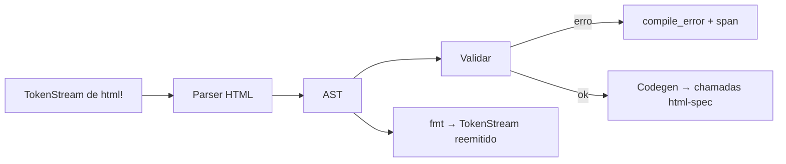
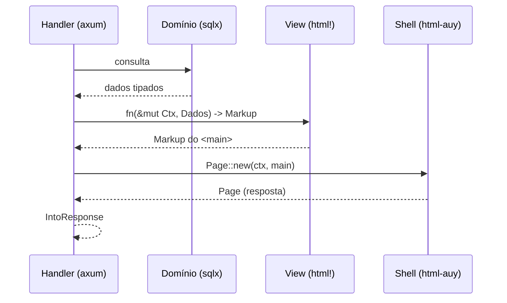

# 01 — Arquitetura

> **Decidido:** [`19-revisao-arquitetural.md`](19-revisao-arquitetural.md) reduz isto a **2 crates, 0
> binários e 0 `build.rs`**, com as mesmas garantias (**D27–D30 aceitas** em 2026-11-06; D21–D26 e D31/D32
> idem — [`13`](13-decisoes.md)). Esta seção descreve o desenho **anterior**, mantido como registro.

## 1. Quatro peças internas

O projeto se organiza em quatro crates de workspace — todos **internos** (não publicados), com
fronteiras que o compilador cobra.

```
html-core      tipos, Markup, escape, valores tipados, Render          (sem proc-macro)
html-spec      spec/elements.toml + build.rs → funções de elemento      (gerado)
html-macro     html! : parser, validação, fmt, codegen                  (proc-macro)
html-lint      validação de página inteira sobre HTML renderizado       (ferramenta)
```

> **Estado (MVP).** O desenho acima é o alvo; a implementação de hoje tem `crates/html` (o antigo
> `html-core`, com `spec/table.rs` gerado e o `audit` opcional no lugar de `html-lint`) e
> `crates/html-macros` (o `html!`), cujo parser/validação/codegen vivem em `html-macros-core` para
> serem fuzzáveis. `html-spec`/`cq` não existem: o gerador é `tools/gen_spec.py`.

Mais um binário de tarefas (`cq`), que era a interface de desenvolvimento:

```
cq check     # roda macro-validate + lint de fonte + lint de saída + testes de conformidade
cq fmt       # reemite o corpo de html! do AST com indentação canônica
cq fix       # aplica correções mecânicas (type="button", aria-hidden em ícone, <figure>)
cq audit     # relatório legível: regra → WCAG SC → onde → como corrigir
cq spec      # valida spec/elements.toml e regenera html-spec
```

> **A revisão corta quatro destes cinco** (`fmt` A2, `fix` A3, `audit` A5, `spec` A1) e propõe cortar o
> próprio binário (**D28**). Na prática de hoje: **os gates são `cargo fmt --check`, `clippy -D warnings`
> e `cargo test`** — nada depende do `cq` para começar (§0 de [`21`](21-implementacao.md)).

### Grafo de dependências (fixo)

```
html-core  ◀── html-spec      (funções de elemento usam os valores de html-core)
    ▲
    ├────────── html-macro    (expande para chamadas de html-spec)
    └────────── html-lint     (não depende de macro; parseia saída com html5ever)
```

Regras:

- `html-core` **não** depende de nada além de `core`/`alloc` (e, opcionalmente, de um escaper próprio).
- `html-spec` é **gerado**; não se edita à mão. Fonte: `spec/elements.toml`.
- `html-macro` depende de `proc-macro2` e `quote` — **não** de `syn` (o fluxo é HTML, não Rust).
- `html-lint` é `dev`/CI apenas; nunca entra no binário de produção.

## 2. Um parser, três passes



O mesmo AST serve para os três usos. Consequências práticas:

- O `fmt` não precisa de gramática própria (é a maior economia do projeto: ~250 LOC em vez de meses).
- Toda regra nova é implementada **uma vez**, no passe de validação, e vale para macro e para `fmt`.
- A validação acontece antes da geração de código, então o erro aponta para o token original, não para
  o código expandido.

### Custo de compilação

- O parser roda uma vez por `html!`; o resultado é código Rust comum.
- Cada `html!` é uma unidade de erro independente: mudar uma view recompila apenas aquele crate de
  view (não a árvore inteira).
- `html-spec` é gerado no `build.rs` e cacheado; só recompila quando `spec/elements.toml` muda.

## 3. Fluxo de uma request (o que o crate vê e o que ele não vê)



Pontos de fronteira:

1. **O crate não busca dados.** Recebe `Dados` prontos. Nenhum acesso a `Pool`, `Clock`, registry,
   `config` ou sessão.
2. **O crate não conhece rotas.** Recebe `LUrl` já construído por quem conhece o roteador.
3. **O crate não decide área.** `Ctx` traz o que a área exige (cookie, CSP, cabeçalhos).
4. **O crate produz `Page`** — `<html>`/`<head>`/`<body>` só existem nele, e `html!` recusa esses
   elementos (`only = "shell"`). O `impl IntoResponse` é do consumidor (6 linhas), porque o crate não
   depende de framework (ver [`06-shell-e-tema.md`](06-shell-e-tema.md), §1).

## 4. Como um módulo se integra (contrato mínimo)

```rust
// view do módulo — nota: nada de I/O, nada de container
pub fn list(ctx: &mut Ctx, d: NewsList) -> Markup {
    html! {
        section class=(Class::of(&[Token::NewsList])) {
            h2 { Msg::LatestNews }
            ul {
                for n in &d.items {
                    li { NewsCard::new(n).render() }   // primitivo do módulo
                }
            }
            @if d.items.is_empty() { EmptyState::new(Msg::NoNews).render() }
        }
    }
}
```

O módulo pode:

- usar os elementos do vocabulário;
- criar **primitivos próprios** (`NewsCard`) que devolvem `Markup` e declaram assets
  (`const ASSETS: &[Asset]`);
- pedir assets ao `Ctx` (`ctx.require(Asset::Editor)`).

O módulo **não pode**:

- emitir `<html>`, `<head>`, `<style>`, `on*`, `<script>` inline; `style=` só como escape hatch auditado;
- resolver rota por string (só `LUrl`);
- escrever texto literal visível (só `Msg`/`Text::new`, para garantir 4 locales).

## 5. Onde vivem as coisas (mapa)

| Preocupação | Onde vive | Nunca em |
|---|---|---|
| elementos, atributos, invariantes | `spec/elements.toml` + `html-spec` | view |
| escape e valores tipados | `html-core` | view |
| sintaxe de `html!` e mensagens de erro | `html-macro` | runtime |
| base estrutural (`<html>`, `head`, `body`) | `html-core::shell` (`Page`) | módulo |
| header/main/footer, regiões e slots | shell do consumidor (dados + `Markup`) | módulo |
| tokens de tema e CSS derivado | dados + emissor de CSS (consumidor) | markup |
| acessibilidade de campo/diálogo/imagem | primitivos (`Field`/`FieldState`) | chamador |
| protocolo de formulário (CSRF, `_method`) | `html-core::form` (`Form::open`) | markup |
| contribuições para o shell (`modals`, `assets`) | `View` (valor devolvido) | pilha ambiente |
| JS e assets | arquivos estáticos + `Ctx::require` | markup |

## 6. O que o crate entrega ao consumidor

1. `html!` com validação.
2. `Markup` + valores tipados reutilizáveis fora do macro (para primitivos escritos em Rust puro).
3. Trait `Render` (para tipos que sabem se desenhar) e `RenderInto` (opcional, para streaming).
4. `Page` + `ShellData` + `View` (o shell como tipo; contribuições como valor — D22/D24).
5. `Form`/`CsrfToken`/`Method` (protocolo de formulário — D23) e `Field`/`FieldState`/`FieldName`
   (`aria-*` derivado — D25).
6. `Class`/`Tone` combináveis (sem attribute bag — D26).
7. `N4` como **módulo atrás de `feature = "audit"`** (`html5ever` opcional), chamável pelo consumidor — D30.
8. Nada mais. Sem framework, sem roteador, sem runtime, sem `IntoResponse`.

## 7. Por que não um único crate

- Um crate único com proc-macro força todo consumidor a compilar a macro mesmo quando só usa
  `Markup`.
- `html-lint` depende de `html5ever` (pesado); se estivesse no mesmo crate, entraria no binário.
- A fronteira `core` / `spec` / `macro` permite testar o gerador sem macro e a macro sem I/O.
