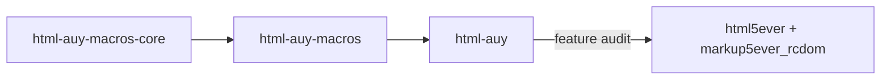
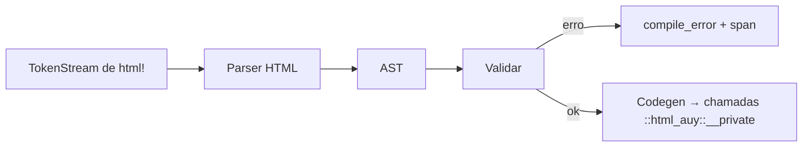
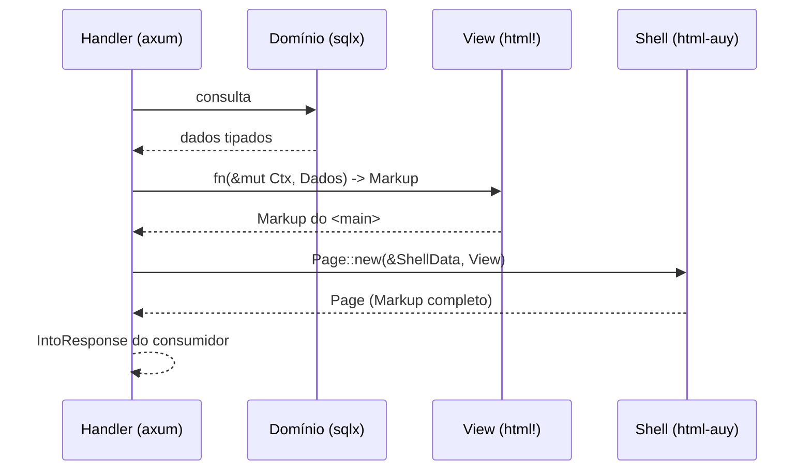

# 01 — Arquitetura

## 1. Três crates publicados

O repositório implementa três crates, em ordem de dependência:

```
html-auy-macros-core   parser, validação e codegen; sem `proc_macro`
        ▲
html-auy-macros        `html!` proc-macro; superfície mínima
        ▲
html-auy               valores, `Markup`, shell, componentes, `audit` opcional
```

| Pacote | Nome Rust | Responsabilidade |
|---|---|---|
| `html-auy-macros-core` | `html_auy_macros_core` | recebe tokens de `html!`, valida contra a tabela e gera chamadas ao crate público |
| `html-auy-macros` | `html_auy_macros` | declara a proc-macro `html!` e delega ao núcleo |
| `html-auy` | `html_auy` | API pública de aplicação: `Markup`, valores, `Page`/`View`, `Form`/`Field`, `audit` |

A aplicação depende somente de `html-auy`. Os outros dois existem porque uma proc-macro não pode
exportar os tipos do crate principal; são publicados para que `html-auy` possa ser instalado do
crates.io.

O workspace também contém `demo/` e `fuzz/`, que **não** são publicados e, no caso do fuzz, tem
workspace próprio (nightly).

## 2. Grafo de dependências



Regras:

- `html-auy` não tem dependência normal por padrão: só `core`/`alloc`. A feature `audit` adiciona
  `html5ever` e `markup5ever_rcdom` para o passe de documento inteiro (D30).
- `html-auy-macros` depende apenas do núcleo; não depende de `html-auy` (evita ciclo).
- `html-auy-macros-core` usa `proc-macro2` e `quote`, **nunca** `syn`: a entrada é HTML, não uma
  árvore Rust arbitrária.
- O núcleo tem uma cópia gerada em `crates/html-auy-macros-core/src/table.rs`; o crate público tem a
  sua em `crates/html-auy/src/spec/table.rs`. `tools/gen_spec.py` mantém as duas idênticas, sem
  `build.rs` (D27). O teste `spec_parity` compara a tabela com `spec/elements.toml`.
- O crate público faz `extern crate self as html_auy` para que o caminho absoluto emitido pelo macro
  (`::html_auy::__private`) também resolva nos testes internos e nos doc-tests.

## 3. Um parser, dois passes



Não existe `fmt` nem binário de tarefas (D28): o macro ignora whitespace e a forma do fonte não
altera os bytes. O AST serve ao parser, à validação e ao codegen; toda regra nova é implementada uma
vez no passe de validação. A validação acontece antes da geração, então o erro aponta para o token
original, não para o código expandido.

### Custo de compilação

- O parser roda uma vez por `html!`; o resultado é código Rust comum.
- Cada `html!` é uma unidade de erro independente: mudar uma view recompila aquele crate de view.
- A tabela é um arquivo Rust versionado; não há gerador em tempo de build.
- Sem a feature `audit`, o crate público não carrega parser de terceiro.

## 4. Fluxo de uma request (o que o crate vê e o que ele não vê)



Pontos de fronteira:

1. **O crate não busca dados.** Recebe dados prontos. Nenhum acesso a `Pool`, `Clock`, registry,
   `config` ou sessão.
2. **O crate não conhece rotas.** Recebe `LUrl` já construído por quem conhece o roteador.
3. **O crate não decide área nem CSP.** Dados de shell (hints, assets, `RootAttributes`) entram como
   valores; cabeçalhos são do consumidor.
4. **O crate produz `Page`** — `html`, `head`, `body`, `title`, `meta`, `link`, `script` e `noscript`
   só existem nele (`only = "shell"`). O `impl IntoResponse` é do consumidor, porque o crate não
   depende de framework (ver [`06`](06-shell-e-tema.md) §1).
5. **Assets são valores ordenados.** `Assets` preserva a ordem declarada, deduplica sem reposicionar
   e aceita CSS/JS internos ou externos por construtores explícitos (D34).

## 5. Como um módulo se integra (contrato mínimo)

```rust
// view do módulo — nada de I/O, nada de container
pub fn list(d: NewsList) -> Markup {
    html! {
        section class=(Class::of(&[Token::NewsList])) {
            h2 { Msg::LatestNews }
            ul {
                for n in &d.items {
                    li { NewsCard::new(n).render() }
                }
            }
            @if d.items.is_empty() { (EmptyState::new(Msg::NoNews).render()) }
        }
    }
}
```

O módulo pode usar o vocabulário, criar primitivos próprios que devolvem `Markup`, e declarar assets
para o `View`/`ShellData`. O módulo **não pode** emitir `html`/`head`/`body`/`style`, `on*` ou
`<script>` inline; `style=` só existe como escape hatch auditado, e texto visível passa por
`Text`/`Msg`.

## 6. Onde vivem as coisas

| Preocupação | Onde vive |
|---|---|
| elementos, atributos, invariantes | `spec/elements.toml` + `html-auy/src/spec/table.rs` |
| escape e valores tipados | `html-auy` (`value/`, `escape.rs`) |
| sintaxe de `html!` e mensagens | `html-auy-macros-core` |
| base estrutural (`html`, `head`, `body`) | `html-auy::shell` (`Page`) |
| header/main/footer, regiões e slots | consumidor, via dados + `Markup`/`View` |
| tokens de tema e CSS derivado | consumidor |
| acessibilidade de campo/diálogo/imagem | `Field`/`FieldState`, `Img`, `Picture`, `Video` |
| protocolo de formulário (CSRF, `_method`) | `Form::open` |
| contribuições para o shell (`modals`, `assets`) | `View` (valor devolvido) |
| JS e assets | arquivos estáticos + `Asset`/`Assets` |
| regras de documento inteiro | `audit` opcional |

## 7. O que o crate entrega

1. `html!` com validação de bloco.
2. `Markup` + valores tipados reutilizáveis fora do macro.
3. Trait `Render` para tipos que sabem se desenhar.
4. `Page`, `ShellData`, `View`, `Assets` (shell como tipo; contribuições como valor).
5. `Form`/`CsrfToken`/`Method` e `Field`/`FieldState`/`FieldName`.
6. `Class`/`ClassList`/`Tone` (estático e dinâmico opt-in; sem attribute bag).
7. `audit` atrás de feature, para o CI do consumidor.

Nada de framework, roteador, runtime, I/O, `IntoResponse` ou binário.

## 8. Por que três crates

- Uma proc-macro não pode exportar os tipos do crate principal; a separação é imposta pela linguagem.
- O núcleo sem `proc_macro` é testável e fuzzável como biblioteca comum.
- `html-auy` fica sem dependências por padrão; `html5ever` só entra com `audit`.
- A fronteira núcleo/macro permite testar o gerador sem expandir macro e a macro sem I/O.
