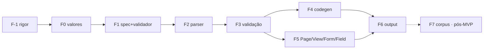

# 21 — Plano de implementação

> **O que é:** a ordem executável para escrever o crate, já com as decisões fechadas
> (**D21–D26**) e as pendentes isoladas (**D27–D30**). Cada fase é um verde de `cargo test`.
> **O que não é:** cronograma. Os números são de código, não de calendário.

## 0. Para começar

> **Critério de leitura:** o uso final está escrito em [`25`](25-exemplo-de-uso.md). Se o exemplo de lá
> não compilar, não gerar os bytes mostrados e não falhar onde está dito, a fase correspondente não está
> pronta — é a definição de "aceito" que vale para F0–F6.
>
> **MVP = F-1 → F6 + F6.1.** O corpus de conformidade (**F7**) e a exportação para outros ecossistemas
> ([`24`](24-exportacao.md)) são **pós-MVP**: estão documentados para não se perderem, mas **não
> bloqueiam nenhuma fase e não entram no primeiro ciclo**. Tema/shell de consumidor (**D29**) também fica
> fora — o crate nasce sem I/O e sem cache.

### 0.1 Pré-requisitos (estado verificado)

| Pré-requisito | Como se verifica | Estado |
|---|---|---|
| `spec/elements.toml` (97 elementos, 73 invariantes) | `python3 tools/validate_spec.py` → `0 erro(s)` | ✅ pronto |
| `docs/00`–`24` + `tools/` (validador de spec, checador de links) | `python3 tools/check_links.py` → `0 quebrado(s)` | ✅ pronto |
| `sniff-css/` **fora** do workspace (workspace próprio, `resolver` próprio) | `ls sniff-css/Cargo.toml` | ✅ isolado |
| `.gitignore` cobrindo `target/`, `*.snap.new`, `fuzz/` | `cat .gitignore` | ✅ pronto |
| **repositório git** | `git rev-parse` | ❌ **não inicializado** |
| toolchain **1.99.0** (o pin que [`22`](22-rigor.md) §2 fixa) | `rustc -V` → `1.99.0` | ✅ instalado e igual ao pin |
| `clippy` + `rustfmt` no 1.99 | `rustup component list --installed` | ✅ instalados |
| **MSRV 1.92** (job de CI da matriz) | `rustup toolchain list` → não aparece | ❌ `rustup toolchain install 1.92 --profile minimal --component clippy` |
| `miri` no nightly (job `miri`) | `rustup component list --installed --toolchain nightly` | ✅ instalado |
| `cargo-deny` 0.20.2 · `cargo-audit` 0.22.2 · `cargo-machete` 0.9.2 · `typos` 1.51.1 · `cargo-fuzz` 0.13.2 | `--version` | ✅ os cinco presentes |
| decisões **D27–D32** | [`13`](13-decisoes.md) | ✅ decididas em 2026-11-06 (§0.4) |

**O que falta é pouco e é objetivo:** `git init` e o toolchain 1.92. O resto do ambiente já atende ao
[`22`](22-rigor.md) sem instalar nada.

### 0.2 Primeiro commit (árvore exata)

Nada de código de domínio ainda: este commit é o **rigor** ([`22`](22-rigor.md)), e ele só é aceitável se
o workspace compilar **vazio**.

```
Cargo.toml                 # [workspace] members = crates/*, resolver = "3", lints, rust-version
rust-toolchain.toml        # channel 1.99 (pin) + clippy + rustfmt
clippy.toml                # msrv = "1.92" + limiares + allowlists
rustfmt.toml               # só opções estáveis (+ hex_literal_case = "Lower")
deny.toml                  # advisories/yanked deny, licenças permissivas, wildcard/registry deny
.github/workflows/ci.yml   # jobs: check, supply-chain, miri, fuzz
crates/html/Cargo.toml     # publish = false, rust-version = 1.92, zero deps por padrão (feature `audit`)
crates/html/src/lib.rs     # no_std + extern crate alloc + doc de topo (nada mais)
crates/html-macros/Cargo.toml
crates/html-macros/src/lib.rs   # proc-macro vazio + doc de topo
```

Aceitação do primeiro commit (rodar **duas vezes**, ADR-001):

```bash
cargo fmt --check
cargo clippy --all-targets --all-features -- -D warnings
cargo test
```

### 0.3 O que **não** fazer no início

| Não | Por quê |
|---|---|
| `syn` no `html-macros` | o fluxo é HTML, não Rust; `proc-macro2` + `quote` bastam ([`01`](01-arquitetura.md) §1) |
| `build.rs` / gerador / esquema de spec | D27 corta: a tabela vive em Rust (`macro_rules!`/`const`) |
| binário `cq` (`fmt`/`fix`/`audit`/`spec`) | D28 corta; o gate é `cargo` puro |
| `publish = true` ou versionamento público | D0: uso interno ([`13`](13-decisoes.md)); `publish = false` no manifesto |
| F7 (corpus) e [`24`](24-exportacao.md) (exportação) | pós-MVP; sem eles o crate funciona |
| tema, shell de tenant, cache | D29: o crate não faz I/O |
| `#[allow]` para "depois eu tiro" | `allow_attributes_without_reason` é `deny`; exceção é `#[expect(…, reason)]` |

### 0.4 Decisões fechadas (2026-11-06)

Todas as pendências foram decididas e estão registradas em [`13`](13-decisoes.md):

| ID | Decisão | Efeito em §1.1 e nas fases |
|---|---|---|
| **D27** | TOML normativo + `tools/gen_spec.py` + teste de paridade | sem `build.rs`; `spec/table.rs` versionado |
| **D28** | sem binário `cq` | gate = `cargo fmt/clippy/test` |
| **D29** | tema/shell de consumidor fora do crate | F5 expõe `Page`+`ShellData`, nada de CSS/`ETag` |
| **D30** | `N4` como módulo atrás de `feature = "audit"` | html5ever opcional; consumidor roda no CI dele |
| **D31** | `Msg` é trait do consumidor; `Text::msg(m)` | F0 não conhece locale |
| **D32** | pin `1.99`; MSRV `1.92` em três lugares | F-1 fixa os dois números |

**Nada disso reverte o critério de parada:** o `M1`/`M3` de [`16`](16-roadmap.md) continua valendo como
teste de que o desenho menor paga — se o `M3` não achar ≥ 3 defeitos reais, o corte foi caro e a reversão
é da peça específica, não da tese.

### 0.5 Ordem do primeiro dia

1. `git init` (o **humano** commita) e o primeiro commit de §0.2.
2. **F-1** fechada: gates verdes duas vezes no workspace vazio.
3. **F0** — tipos e valores, **sem macro**; é a fase do **M1** ([`16`](16-roadmap.md)) e o **ponto de
   parada**: se F0 não pagar, o plano B é maud + estes mesmos valores (`html` de ~600 LOC), e F2–F6 não
   começam.

## 1. Regras de execução

| Regra | Consequência prática |
|---|---|
| workspace com **2 crates** (`html`, `html-macros`) | `html` só depende de `core`/`alloc`; `html-macros` só de `proc-macro2`+`quote` (nunca `syn`) |
| gate único: `cargo fmt --check` + `cargo clippy --all-targets -- -D warnings` + `cargo test` | não há binário de tarefas: o `cq` não existe (D28 pendente; até lá, nada depende dele) |
| **1 mensagem de erro = 1 caso `trybuild`** | `crates/html-macros/tests/ui/*.rs` + `.stderr`; o texto de [`10`](10-ergonomia.md) §2 é contrato |
| **1 saída canônica = 1 snapshot `insta`** | `crates/html/tests/snapshots/`; bytes determinísticos são testados, não prometidos |
| nenhum `HashMap` em ordem de saída | `BTreeMap`/`Vec` ordenado; sem tempo, sem `rand`, sem ordem de FS (ADR-001 do projeto pai) |
| uma fase por vez, sempre verde | fase 4 não começa com fase 3 vermelha |
| `sniff-css/` é workspace **independente** | tem `Cargo.toml` próprio e `resolver` próprio: não entra em `members`, não é tocado por `cargo fmt --all`/`clippy --workspace` daqui |

### 1.1 `Cargo.toml` de partida

```toml
# Cargo.toml (workspace)
[workspace]
members = ["crates/html", "crates/html-macros"]
resolver = "3"
# `exclude` explícito: `sniff-css/` e `spec/` não são membros


[workspace.lints.rust]
unsafe_code = "forbid"
missing_docs = "warn"

[workspace.lints.clippy]
pedantic = { level = "warn", priority = -1 }
```

```toml
# crates/html/Cargo.toml
[package]
name = "html"
edition = "2024"
rust-version = "1.92"          # MSRV; o pin do toolchain vive no rust-toolchain.toml
publish = false                # D0: não vai para crates.io

[lints]
workspace = true

[dependencies]                 # nenhuma, por padrão: só core/alloc
html5ever = { version = "0.27", optional = true }   # `output` (D30)

[features]
audit = ["dep:html5ever"]      # `N4` chamável pelo consumidor, fora do binário sem a feature

[dev-dependencies]
insta = "1"
proptest = "1"
```

```toml
# crates/html-macros/Cargo.toml
[package]
name = "html-macros"
edition = "2024"
rust-version = "1.92"
publish = false

[lib]
proc-macro = true

[lints]
workspace = true

[dependencies]
proc-macro2 = "1"
quote = "1"                    # nunca `syn`: o fluxo é HTML, não Rust

[dev-dependencies]
trybuild = "1"
```

## 2. Estado de partida

- `spec/elements.toml`: **97 elementos**, **73 invariantes** (62 `block` / 6 `type` / 5 `output`),
  `only`: 9 `shell` (`html head body title meta link script noscript h1`) + 1 `component` (`form`).
- `docs/00`–`24`: contrato completo (o que é garantia, o que é gate, e por quê).
- `tools/validate_spec.py`: **a especificação executável do validador** — categorias, conteúdo-modelo,
  globais, escopos, `only`, rastreabilidade com `docs/04`, contagem nos docs. É a referência a portar;
  quando o passe de validação existir em Rust, o script sai.

## 3. Fases

### F-1 — rigor antes de qualquer linha (≈0 LOC de código, 6 arquivos)

Não é código; é o chão. Absorvido de [`22`](22-rigor.md), derivado do `sniff-css`:

| Arquivo | Conteúdo |
|---|---|
| `rust-toolchain.toml` | `channel = "1.99"` (pin), `components = ["clippy", "rustfmt"]` |
| `Cargo.toml` | `[workspace.package] rust-version = "1.92"` (**MSRV**, ≠ pin), `publish = false`, `resolver = "3"`, `[workspace.lints.rust]`/`[workspace.lints.clippy]`/`[workspace.lints.rustdoc]` |
| `clippy.toml` | limiares + allowlists (incl. `msrv` e `doc-valid-idents`) |
| `rustfmt.toml` | só opções estáveis + `hex_literal_case = "Lower"` |
| `deny.toml` | advisories/`yanked` deny, allowlist de licença permissiva, wildcard/registry deny |
| `.github/workflows/ci.yml` | jobs `check`, `supply-chain`, `miri`, `fuzz` |

**DoD.** `cargo fmt --check`, `cargo clippy -- -D warnings`, `cargo test` e `cargo deny check` verdes num
crate vazio; nenhum `#![allow]` no workspace; `unsafe_code = "forbid"`.

### F0 — valores tipados, sem macro (≈700 LOC)

**Objetivo:** o plano B formal. Se o macro falhar, isto já vale ([`16`](16-roadmap.md) M1).

| Arquivo | Conteúdo |
|---|---|
| `html/src/markup.rs` | `Markup`, `Render`, buffer único (sem alocação intermediária) |
| `html/src/escape.rs` | tabela dos 5 caracteres + entidades numéricas de controle |
| `html/src/value/*.rs` | `Text`, `AttrVal`, `Href`, `Src`, `SrcSet`, `Alt`, `WidthPx`, `HeightPx`, `Class`, `Tone`, `Label`, `Id`, `FieldName`, `JsonLd` |
| `html/src/msg.rs` | `pub trait Msg: Copy { fn as_str(self) -> &'static str; }` + `Text::msg(m)` (D31: o enum é do consumidor; o crate não conhece locale) |

**API (contrato do crate):**

```rust
pub struct Markup(/* buffer */);
impl Markup { pub fn render_to(&self, out: &mut String); }
pub trait Render { fn render_to(&self, out: &mut String); }

impl Alt<'_>  { pub fn new(s: &str) -> Self; pub fn decorative() -> Self; }        // sem vazio implícito
impl SrcSet<'_> { pub fn add(self, url: Src<'_>, w: WidthPx) -> Self; }           // ordena e deduplica
impl Class { pub fn of<T: ClassToken>(t: &[T]) -> Self; pub fn extend(self, o: Class) -> Self; } // bitset, ordem canônica
impl Href { pub fn internal(LUrl<'_>) -> Self; pub fn external(ExternalUrl<'_>) -> Self; /* mailto, tel */ }
```

**Testes.** `proptest` para escape (`<>&"'` + controle), `SrcSet` (ordem, dedupe, largura > 0), `Class`
(dedupe, ordem). `insta` para 3 saídas.
**DoD.** `cargo test` verde; `Markup` não implementa `IntoResponse` (não há dependência de `http`);
`grep -r http crates/html` vazio.

### F1 — tabela de elementos + porte do validador (≈400 LOC)

**Objetivo:** a spec deixa de ser um arquivo lido só por Python. As **regras** (o que é válido) são as
mesmas em qualquer caminho — o que muda é onde a tabela mora:

| Caminho | Tabela | Gate |
|---|---|---|
| vigente (até D27) | `html-spec` gerado por `build.rs` a partir de `spec/elements.toml` | divergência = build quebrado (registro histórico) |
| **decidido (D27)** | `spec/elements.toml` **normativo** → `tools/gen_spec.py` (manual) → `crates/html/src/spec/table.rs` **versionado** | **teste de paridade**: TOML ≠ tabela = CI vermelho; nenhum `build.rs` |

**Artefatos de F1:** `tools/gen_spec.py` (o gerador), `crates/html/src/spec/table.rs` (saída, commitada) e
`crates/html/tests/spec_parity.rs` (a prova de que a saída não está velha). Esquecer de rodar o gerador
deixa o CI vermelho, nunca o produto errado.

```rust
// html/src/spec/mod.rs
pub struct Element { pub name: &'static str, pub categories: &'static [Cat], pub required: &'static [&'static str],
                     pub allowed: &'static [&'static str], pub children: &'static [Cat], pub only: Option<Only>,
                     pub invariants: &'static [&'static str], pub void: bool }
pub static ELEMENTS: &[Element] = &[ /* 97 */ ];
pub enum Only { Shell, Component }
```

**Testes.** Os mesmos do `validate_spec.py`: 97 elementos; cada invariante usada tem escopo; `only`
exige a invariante correspondente (`shell_only_elements` / `form_requires_csrf`); `children` alcançável
a partir de `body`; `docs/04` cobre 100% das invariantes; contagem declarada em `docs/03`/`docs/04` bate.
**DoD.** `cargo test spec` cobre cada regra do script Python; o script passa a ser redundante (só é
removido quando o macro começar a validar — F3).

### F2 — parser (≈900 LOC, inclui congelar a gramática de atributo)

**Sintaxe** (a de [`10`](10-ergonomia.md) §1 e do exemplo de [`25`](25-exemplo-de-uso.md) §3–§5):
elemento `nome { … }`, elemento vazio `nome attr=(expr);` (o `;` fecha o `void`), atributo
**`nome=(expr)`** para valor calculado e
**`nome="literal"`** só quando a spec declara o atributo como enumerado (`type`, `method`, `rel`,
`target`, `inputmode`…), texto como **expressão nua** (`Msg::X`, `Text::new(&s)`) ou `{ expr }` quando vem
de um bloco, `@if/@else`, `for x in itens { … }`, e **primitivo do consumidor** como
`Caminho::funcao(args)` (sem filhos, devolve `Markup`) ou `Caminho::funcao(args) { filhos }` (o macro
passa os filhos como `Markup` — é como `Form::open`, `Field` e `EmptyState` entram na view). Os parênteses do valor **não são estilo**: delimitam a expressão no `TokenStream` (sem eles,
`href=x rel=y` é ambíguo).
**Erros com span:** tag não fechada, tag fechada errada, atributo sem valor, texto depois de `}`.
**Testes.** 20 snippets parseados; `trybuild` para 4 erros de sintaxe.

### F3 — validação (≈500 LOC) — **o coração**

Porte 1:1 das regras de `validate_spec.py`, agora com span no token:

| Regra | Mensagem (contrato de [`10`](10-ergonomia.md) §2) |
|---|---|
| elemento desconhecido | `error: elemento desconhecido \`dev\`; você quis dizer \`div\`?` |
| atributo desconhecido | `error: atributo desconhecido \`hreff\` em \`a\`` + lista de válidos |
| atributo obrigatório ausente | `error: \`img\` exige \`alt\`` + `regra:`/`ajuda:` |
| aninhamento ilegal | `error: \`<div>\` não é permitido dentro de \`<p>\`` + alternativa |
| valor fora do enum | `error: \`type="texto"\` não é válido em \`input\`` + valores aceitos |
| elemento de documento | `error: \`<html>\` só existe no shell: use \`Page::new(…)\`` |
| `<form>` à mão | `error: \`<form>\` só existe via \`Form::open(action, method, &CsrfToken)\`` |

**Testes.** `trybuild`: **um caso por mensagem** (as 7 acima + os enums/aria + `label`/`id` + `srcset` +
`role`), `insta` para os `.stderr` (a mensagem é artefato versionado).
**DoD.** Nenhuma regra existe só no Python; `N4` (F6) não é necessário para `block`.

### F4 — codegen (≈250 LOC)

Ordem de atributos = ordem da spec; boolean atributo (`checked`) por presença; `Class` em ordem canônica;
`SrcSet` já ordenado; escape na escrita.
**Testes.** `insta` com 10 fragmentos; um teste de **bytes**: renderizar duas vezes dá o mesmo `String`.
**DoD.** `ETag` do consumidor é estável por construção.

### F5 — `Page`, `View`, `Form`, `Field` (≈430 LOC; D22–D25)

```rust
// html/src/shell.rs  — `ShellData` é DADO; tema/CSS/ETag ficam no consumidor (D29)
pub struct ShellData<'a> { pub title: &'a str, pub heading: &'a str, pub lang: Lang, pub assets: &'a BTreeSet<Asset>,
                           pub regions: Regions, /* … */ }              // title/heading NÃO opcionais
pub struct View { pub main: Markup, pub modals: Vec<Markup>, pub assets: BTreeSet<Asset> }
impl View { pub fn new(m: impl Into<Markup>) -> Self; pub fn modal(self, m: impl Into<Markup>) -> Self;
            pub fn merge(self, o: View) -> Self; }
impl Page { pub fn new(data: &ShellData<'_>, view: View) -> Self; }

// html/src/form.rs
pub struct CsrfToken<'a>(&'a str);
pub enum Method { Get, Post, Put, Patch, Delete }
impl Form { pub fn open(action: &Action, method: Method, csrf: &CsrfToken) -> FormBody; }

// html/src/field.rs
pub struct FieldState<'a> { pub valor: AttrVal<'a>, pub erro: Option<Text<'a>>, pub ajuda: Option<Text<'a>> }
impl Field { pub fn text<M: Msg>(n: FieldName, label: M, s: &FieldState<'_>) -> Markup; }
```

**Testes (aqui mora o valor das D23–D25):**

| Caso | Prova |
|---|---|
| `Form::open` sem token | `trybuild` → não compila |
| `PUT`/`PATCH`/`DELETE` | `insta` → `_method` presente; `GET`/`POST` → ausente |
| `Page::new` sem `title`/`heading` | `trybuild` → não compila |
| dois `main` / `h1` no fragmento | `trybuild` → `html!` recusa (F3) |
| `View` com 2 modais | `insta` → ambos na região, ordem estável; `merge` dedupe de `assets` |
| `Field` com erro | `insta` → `aria-invalid="true"` + `aria-describedby` com os dois ids |
| `Field` sem erro | `insta` → **sem** `aria-invalid` e **sem** o id de erro |

### F6 — `output` (`N4`) atrás de feature (≈250 LOC; D30)

Parse com `html5ever` (dependência **opcional**, `features = ["audit"]`) + as **5** invariantes de
`output`: `landmark_names_distinct`,
`no_content_derived_identifiers`, `ids_unique`, `heading_levels_no_skips`, `popover_target_resolves`
([`23`](23-acessibilidade-e-css.md) §2.1).
**DoD.** `html::audit::check(&page.markup())` roda no CI **do consumidor** em três linhas
(`html = { path = …, features = ["audit"] }`); sem binário e sem crate novo. Sem a feature, o crate tem
zero dependências — provado por `cargo tree -e normal` no job `check`.

### F6.1 — gate do consumidor para `data-*` (≈60 LOC, **fora** do crate)

D26 decide que o conjunto de `data-*` pertence ao JS do consumidor, não ao crate. O gate fecha o buraco:

| Checa | Falha quando |
|---|---|
| `spec/data.toml` ↔ uso no markup | nome usado e não declarado (ou declarado e não usado) |
| `spec/data.toml` ↔ leitor no JS | nome declarado que nenhum bundle lê (`[data-x]`, `dataset.x`) |
| valor | o valor do atributo não está no enum declarado (ex.: `data-mask` fora de `cpf\|cnpj\|phone\|money`) |

**DoD.** Uma tabela, três consultas, uma saída; mesmo formato do `validate_spec.py` (linha por problema,
código de saída 1).

### F7 — corpus de conformidade (exportação) — **pós-MVP, não bloqueia o crate**

Gerado **dos** `trybuild` de F3 + das regras de F6, no formato de
[`24`](24-exportacao.md) §3 (`id`, `input`, `expect`, `invariant`, `scope`). É o artefato que permite
qualquer outro ecossistema implementar as mesmas regras sem virar dialeto.

**DoD.** 100% dos casos `reject` citam `invariant`; todo `invariant` do corpus existe na spec; o corpus e os
`trybuild` não divergem (teste que falha quando um caso não tem par).

## 4. Ordem



F0 é o **ponto de parada**: se F0 não pagar (M1 de [`16`](16-roadmap.md)), o plano B é maud + valores
tipados, e as fases F2–F6 não começam.

## 5. Aceitação (antes de "pronto")

Portar os dois componentes reais ([`20`](20-fronteira-de-aplicacao.md) §5) com os critérios numéricos:

| Componente | Critério |
|---|---|
| `picture` (77 linhas Blade) | ≤ 1,3× LOC; **≥ 3** defeitos recusados (`alt` vazio, dims, `sizes`, classe string) |
| `select` (110 linhas Blade) | ≤ 1,3× LOC; **zero** `aria-*` escrito à mão |

Falhou o critério → **o DSL tem buraco**: conserta o buraco ou corta o item. Nunca "aceita porque é mais
seguro".

## 6. Riscos e ponto de parada

| Risco | Sinal | Ação |
|---|---|---|
| spans ruins | mensagem aponta linha errada em 2 casos | consertar antes de F3 fechar (span é o produto) |
| macro lento | > 200 ms em 200 views | medir antes de otimizar; `cargo build` incremental é o alvo |
| DSL ergonomicamente caro | porte de §5 > 1,3× | simplificar sintaxe (nunca a validação) |
| escopo crescendo | pedido de `style`/`on*`/bag | recusar: é a garantia (§4 de [`20`](20-fronteira-de-aplicacao.md)) |

## 7. DoD global

1. `cargo test` verde **2× seguidas** (sem flaky).
2. `clippy -D warnings` limpo; zero `allow` (só `#[expect(…, reason)]` pontual — [`22`](22-rigor.md) §10).
3. `cargo deny check` + `cargo audit` + `cargo machete` + `typos` verdes; `cargo fuzz run parser` sem
   pânico em 30 s.
4. Toda mensagem de erro de [`10`](10-ergonomia.md) §2 tem `trybuild`.
5. `html` sem nenhuma dependência de runtime além de `core`/`alloc`.
6. `Page`, `Form`, `Field`, `View` com os testes de F5 na tabela.
7. Porte de §5 dentro dos critérios numéricos.
8. `tools/validate_spec.py` removido **somente** quando F3 cobrir 100% das suas regras (até lá, ele é o
   gate da spec).
