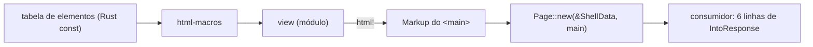

# 19 — Revisão arquitetural: a menor máquina que cumpre os objetivos

> **Documento histórico.** O desenho abaixo antecede o 0.1.0 público; nomes `html-core`/`html-spec`/`html-macro` referem-se a crates da fase interna. O estado atual está em [`01`](01-arquitetura.md) e D35 em [`13`](13-decisoes.md).


> **O que é:** uma revisão crítica do próprio desenho, feita depois dos 14 corpus. O critério é único:
> **cada garantia tem que ser cobrada por uma máquina que falha**, com o menor número de peças móveis.
> Complexidade que não compra garantia é dívida.
> **O que não é:** reescrita. As §7 e §8 estão aplicadas; §5–§6 são proposta com custo e risco.

> **Mapa de leitura (importante).** Os documentos **01–18 descrevem o desenho anterior** a esta revisão.
> Onde eles dizem `cq` (qualquer subcomando), `build.rs`, `html-spec` gerado, `html-lint` como crate ou
> "quatro crates", leia como **histórico**: o estado vigente é este documento (§2, §7) + [`21`](21-implementacao.md)
> (plano, com `## 0. Para começar`) + [`22`](22-rigor.md) (rigor). Não foram reescritos um a um para
> preservar o registro da decisão; **o plano e o rigor vencem sempre**.

## 1. O diagnóstico em sete linhas

O desenho atual entrega quatro garantias reais — vocabulário fechado, aninhamento válido, bytes
determinísticos, base estrutural inescapável — e monta **cinco mecanismos** para elas: quatro níveis de
validação (`N1`–`N4`), um binário (`cq`), um crate gerado (`html-spec` + `build.rs`), um lint separado
(`html-lint`) e um formatter (`cq fmt`). O problema não é o tamanho: é que boa parte dessas peças
**cobra disciplina em vez de cobrar do compilador** — e disciplina é a única dependência que o projeto
declarou não querer.

## 2. Achados, com evidência

| # | Achado | Evidência no repositório | O que compra | Veredito |
|---|---|---|---|---|
| A1 | **Spec como dado gerado** custa mais do que rende | `spec/elements.toml` (900 linhas) + `build.rs` + "esquema 2" (migração v1→v2) + `tools/validate_spec.py`; o próprio repositório já acusava "63 elementos" com 97 na tabela, e precisei **adicionar um gate de contagem** para isso virar falha | tabela auditável | **cortar**: tabela em Rust (const/macro), sem esquema, sem geração; a checagem de docs passa a ser um teste |
| A2 | **`cq fmt` é um segundo printer** | `docs/design/01` §2 promete "o maior ganho do projeto: 250 LOC em vez de meses" | formatação canônica | **cortar**: a macro já emite ordem canônica; o fonte é formatado pelo rustfmt |
| A3 | **`cq fix` faz o que o tipo deveria fazer sozinho** | `docs/design/01` §1: `fix` aplica `type="button"`, `aria-hidden`, `<figure>` | correção mecânica | **cortar**: se a correção é mecânica, o gerador a aplica silenciosamente (default), sem CLI |
| A4 | **Camada advisory (N3) não é garantia** | `docs/design/04` §5 + D10: aviso com ratchet e ledger | nada bloqueia | **cortar**: ou é erro de compilação, ou é teste que falha; aviso sem consequência é documentação de pior qualidade |
| A5 | **`cq audit` é relatório que ninguém lê** | `docs/design/01` §1 | — | **cortar**: a informação já é `grep`ável nos docs |
| A6 | **`N4` como crate `html-lint`** | `docs/design/01` §1/§7 (html5ever "pesado", não entra no binário) | lint de página | **virar `dev-dependency` + teste**: o consumidor roda no CI dele, não num binário nosso |
| A7 | **Invariantes de página anunciadas como de compilação** | 73 invariantes; eram **8 de página**, restam **5** (2 entraram do catálogo de a11y — [`23`](23-acessibilidade-e-css.md)) (`single_h1`, `main_unique`, `landmark_names_distinct`, …) | promessa falsa | **corrigido** (§7.1): escopo declarado no spec; a macro só cobra `block` |

## 3. Onde o desenho já está certo (não mexer)

1. **`html!` com sintaxe de HTML.** É o produto: quem escreve HTML reconhece a view. Trocar por
   `div(...)` (maud) economiza 1,4k LOC de parser e destrói a proposta.
2. **Valor tipado por contexto** (`Href`, `Src`, `Alt`, `SrcSet`, `JsonLd`, `Class`, `Msg`). É o que
   torna `hreff`/`alt=""` impossível, e é ~600 LOC.
3. **Ordem canônica + bytes determinísticos.** `ETag` só significa algo se o byte for contrato.
4. **Escape na escrita, sem buffer intermediário.** Simples e correto.
5. **Sem `|safe`, sem `Raw` público, sem `style`/`on*`.** O escape hatch é o defeito que o projeto existe
   para fechar.
6. **Um escopo por invariante, agora declarado.** A distinção `block`/`page` é o que permite frases
   honestas ("o compilador recusa" × "o gate recusa").

## 4. A forma mais simples que cumpre os objetivos



| Peça | Hoje | Proposto |
|---|---|---|
| crates | `html-core`, `html-spec` (gerado), `html-macro`, `html-lint` | **2**: `html` (core + shell + `Class`) e `html-macros` |
| binários | `cq` (check/fmt/fix/audit/spec) | **0** |
| `build.rs` | 1 (gerador) | **0** |
| dependências de produção | `proc-macro2`, `quote`, `html5ever` (lint) | `proc-macro2`, `quote` |
| dependências de dev | insta, trybuild, proptest, fuzz, criterion, mutants | insta, trybuild, proptest, `html5ever`, fuzz |
| LOC estimadas | ~3.600 | **~2.300** |
| tabela de elementos | TOML + esquema + gerador + validador externo | `const` em Rust, uma escrita só |
| garantias | 4 | **4** (mesmas) |

O que **não** muda: o que o desenvolvedor escreve na view. A superfície de uso é idêntica — o que
encolhe é o que existe para sustentá-la.

### 4.0.1 O que a matriz de defeitos prova

[`14-alternativas.md`](14-alternativas.md) §2.1 compara 15 defeitos reais em Askama, JSX e `html!`: os dois
primeiros recusam 1 e 2 respectivamente; o terceiro recusa os 15. A diferença não é esforço, é **posse da
tabela de elementos** — e é essa posse que os cortes desta revisão preservam (o corte é *onde a tabela
mora*, nunca *se existe*).

### 4.1 Por que a tabela em Rust e não em TOML

O argumento a favor do TOML era "quem não é de Rust pode editar". Ele não sobrevive ao fato de que
**todo atributo tem tipo**: editar `allowed = [...]` sem saber o tipo produz erro de compilação numa
linha que o editor não entende. Em compensação, a tabela em Rust dá:

- `rustdoc` de cada elemento e atributo, de graça;
- **erro de compilação** quando a tabela e o macro divergem (em vez de divergência silenciosa);
- zero `build.rs` (compilação incremental melhor, sem `OUT_DIR`);
- zero esquema versionado, zero migração de esquema, zero validador externo em Python.

E a forma mais barata de escrever 97 elementos é `macro_rules!` sobre a mesma sintaxe declarativa:

```rust
elements! {
    a    : phrasing, interactive => required(href), allowed(hreflang, target, download, type),
           children(phrasing), forbid(a, button, input, select, textarea, details, summary, dialog),
           name(required), invariants(href_is_typed, a_rel_enum, referrer_policy_enum);
    img  : phrasing, media, void => required(src, alt, width, height), allowed(srcset, sizes, loading),
           name(alt), invariants(alt_empty_means_decorative, intrinsic_dimensions_required);
    // …
}
```

Uma tabela, um lugar, um formato que o compilador lê. `spec/elements.toml` continua útil como
**documento de leitura** gerado a partir dela (`cq` não existe mais: um teste normal escreve o arquivo
e falha se ele estiver velho).

### 4.2 Por que o tema sai do crate

`docs/design/06` descreve tokens `oklch`, `@property`, precedência de cinco camadas, `/theme.css` com `ETag`,
preview e contraste verificado no save. Isso é um **segundo produto** — precisa de armazenamento, HTTP,
cache e um painel — e não tem relação com "o HTML não pode ser emitido de forma inválida". O crate
precisa apenas de duas coisas, e as duas são tipo:

- `Class`/`Tone` com enum fechado (o chamador não escreve string de classe);
- `data-*` tipado (o JS lê estado, não adivinha).

O resto vira contrato do consumidor. Consequência prática: some a obrigação de manter geração de CSS,
cache de tema e algoritmo de contraste dentro de um crate que não faz I/O.

## 5. O que o crate passa a **não** garantir (e quem garante)

| Alegação a remover | Quem passa a cobrar |
|---|---|
| "um `<h1>` por página", "um `main`", "landmarks com nomes distintos" | `N4` (teste) — escopo `page` no spec, já declarado |
| contraste, alvo mínimo, ordem de foco, `CLS` | `axe` + `sniffCSS` + Playwright no consumidor |
| comportamento de JS pós-swap (foco, `aria-busy`) | e2e do consumidor; o crate só emite o contrato |
| tema, tokens, `/theme.css`, preview | consumidor (`docs/design/06` vira contrato de shell, não código do crate) |
| "performance < 20 µs" | benchmark informativo; `LCP`/`INP` são de campo, nunca teste de parede |

A frase que resume a fronteira: **o crate garante o que o compilador consegue recusar; o resto é gate
que falha.** Depois desta revisão, nenhuma promessa fica em cima de "o desenvolvedor lembra".

## 6. Risco de cortar (o que pode quebrar)

| Corte | Risco real | Mitigação |
|---|---|---|
| `build.rs`/gerador | escrever 97 elementos à mão tem custo inicial | `macro_rules!` declarativo; 1 dia; o gerador atual pode *emitir* a tabela uma única vez |
| tabela fora de TOML | diffs de revisão menos legíveis | a tabela é o diff; 97 blocos curtos |
| camada advisory | perde-se o "aviso educativo" | mensagem de erro já traz `o que → por quê → como corrigir`; aviso que não bloqueia não é lido |
| `cq fmt` | fonte de `html!` fica na mão do rustfmt | a macro ignora whitespace por construção; nenhuma saída depende de formatação |
| `cq fix` | correções viram default do gerador | `type="button"` e `rel="noopener"` são derivados, não corrigidos |
| `html-lint` como crate | consumidor precisa rodar o teste | `dev-dependency` + `n4::check(&html)` em 3 linhas |
| tema fora | consumidor reimplementa tokens | é o trabalho dele; o crate entrega `Class` e `data-*` |

## 7. Aplicado nesta revisão

> **Estado vigente (0.2.0):** 71 invariantes = 59 `block` / 4 `type` / 8 `output`. Os números
> abaixo são a foto desta revisão, não a contagem atual.

1. **Escopo por invariante** (`spec/elements.toml` → `[invariants]`): **62 `block`** (a macro recusa),
   **6 `type`** (`Page`/`Form` não deixam compilar sem o dado) e **5 `output`** (só o HTML final
   responde). `validate_spec.py` falha se uma invariante usada não declarar escopo. Documentado em
   [`04-validacao.md`](04-validacao.md) §4.0.
2. **Elementos de documento não compilam em `html!`**: `html`, `head`, `body`, `title`, `meta`, `link`,
   `script` e `noscript` marcavam `only = "shell"` e carregavam `shell_only_elements` (escopo
   `block`). A "base estrutural impossível de contornar" deixou de ser convenção: virou erro de
   compilação — e o mesmo movimento converteu 5 regras de página em regras de tipo (§4.0 do docs/design/04).
   **Emenda 0.1.0:** `h1` saiu de `only = "shell"`; a view pode declarar o heading e `single_h1` passou
   a `output` (ver docs/design/04 §4.0).
3. **Fronteira de framework resolvida**: `Page`/`ShellData` no core (sem `http`), `impl
   IntoResponse` do consumidor em 6 linhas ([`06`](06-shell-e-tema.md) §1, [`01`](01-arquitetura.md) §3).

## 7.1 Os seis padrões de Blade (o que o crate absorve e o que não)

Medido no corpus real (225 `.blade.php`, 150 nomes de `data-*` distintos): attribute bag **478**,
`@stack`/`@push` **5/3**, `@csrf`/`@method` **142/57**, `old()`/`$errors` **188/204**, plural
`@choice`/`trans_choice` **22**, componente dinâmico **1 + registry**. O
destino de cada um, com a forma de API e o custo, está em
[`20-fronteira-de-aplicacao.md`](20-fronteira-de-aplicacao.md). Resumo: **absorve** `Form`+CSRF,
`View` (substitui pilha), `FieldState` e `Class` combinável; **não absorve** attribute bag, plural e
componente por string — e cada recusa tem um motivo de garantia, não de preguiça.

## 7.2 Portabilidade: o que sustenta o projeto fora do Rust (**pós-MVP**)

[`24-exportacao.md`](24-exportacao.md) fecha a pergunta "isto vira PHP/Node/Java?": **spec + modelo de
valores + corpus de conformidade** viajam (L0/L1/L2 ≈ 90–100%); o macro (L3) não. O teto de cada
linguagem é diferente e é normativo: Node/TS chega a build-time (JSX + plugin), Java/C# a compile-time
(Error Prone/Roslyn), **PHP para no gate** (Blade linter + PHPStan) — e o escopo declarado por invariante
(`block`/`type`/`output`) é o que impede um port de alegar mais garantia do que tem.

**Decisão de sequência:** fica para **depois** do crate funcionar (F6). O único efeito no MVP é não
perder o corpus: F3 já produz os casos, F7 só os exporta.

## 8. Decisões propostas — **decididas em 2026-11-06**

**Aceitas nesta revisão:** D21 (escopo por invariante), D22 (documento só no `Page`), D23 (`Form`+CSRF),
D24 (`View`), D25 (`Field`/`FieldState`), D26 (`Class` combinável, sem bag).

**Situação do §8:** os quatro cortes abaixo **foram aceitos**, com duas emendas na ratificação — D27 mantém
o TOML normativo (gerador em `tools/`, paridade testada) e D30 vira **módulo atrás de feature** em vez de
`dev-dependency`. O texto de D27–D30 é o registro da proposta; a decisão vigente está em
[`13-decisoes.md`](13-decisoes.md) **D27–D32** (inclui D31 `Msg` e D32 toolchain, que não estavam aqui).

| ID | Proposta | Custo | Ganho medido |
|---|---|---|---|
| **D27** ✅ | dois crates, sem `build.rs`/codegen; tabela em Rust — **emendado:** TOML continua normativo, gerador em `tools/`, teste de paridade | ~1 dia | −1 crate, −1 esquema, −1 validador externo, −300 LOC geradas |
| **D28** ✅ | sem camada advisory e sem `cq` (check/fmt/fix/audit) | ~1 dia | −1 binário, −~700 LOC, −ratchet/ledger; `cargo test` + `clippy` cobrem |
| **D29** ✅ | tema e shell de consumidor fora do crate (só `Page` + `ShellData` + `Class`) | ~meio dia de docs | −1 produto interno; crate sem I/O e sem cache |
| **D30** ✅ | `N4` como `dev-dependency` + teste, não crate/binário — **emendado:** módulo atrás de `feature = "audit"` (o `dev-dependency` não é alcançável pelo consumidor, e o `M3` exige rodar no CI dele) | ~meio dia | −1 crate, −1 pipeline de CI |

Ordem de execução: **D28 → D27 → D30 → D29** (cada passo deixa `cargo test` verde e o consumidor
compilando).

**Critério para aceitar ou recusar a simplificação:** rodar o `M3` (≥ 3 defeitos reais que o desenho
atual não pegava) **antes** e **depois**. Se o número de defeitos reais cair junto com o número de
peças, o corte foi caro: reverta o corte específico, não a tese.