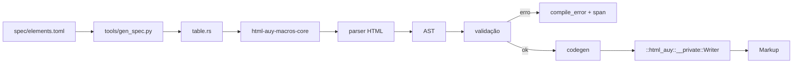
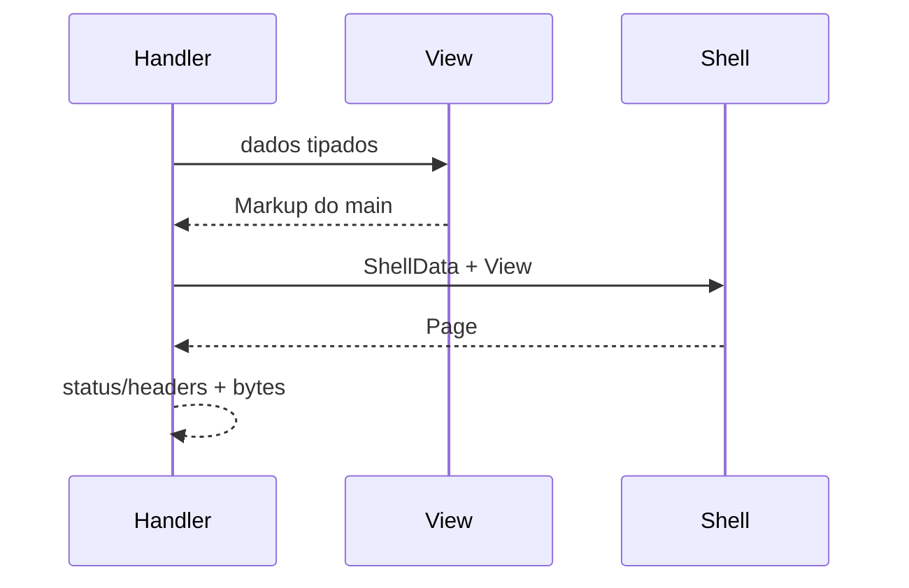

[← Receitas](14-receitas.md) · [Índice](README.md) · [Próximo →](16-projeto-minimo-axum.md)

# 15 — Como a biblioteca funciona

**Em uma frase.** O `html!` é compilado contra uma tabela versionada de elementos; o runtime só
escreve bytes canônicos, e o `Page` compõe o documento.

## Três crates

```text
html-auy-macros-core   parser, validação e codegen (sem proc_macro)
        ▲
html-auy-macros        declara html! e delega ao core
        ▲
html-auy               tipos públicos, shell, componentes, audit opcional
```

| Pacote | Papel | Dependências |
|---|---|---|
| `html-auy-macros-core` | recebe tokens, valida contra a tabela, gera código | `proc-macro2`, `quote` |
| `html-auy-macros` | declara `#[proc_macro] fn html` | `html-auy-macros-core` |
| `html-auy` | `Markup`, valores, `View`/`Page`, `Form`/`Field`, `audit` | nenhuma no default; `audit` puxa parser |

Uma proc-macro não pode exportar os tipos do crate principal; por isso os três pacotes. A aplicação
depende só de `html-auy`.

## Compilação de `html!`



1. O parser lê o bloco de marcação (não é Rust arbitrário; não há `syn`).
2. A validação consulta a tabela: elemento, atributo, conteúdo-modelo, invariantes.
3. O codegen emite chamadas ao `Writer`; o `Writer` já conhece a ordem canônica, a presença de
   booleanos e o escape.
4. O resultado é uma expressão que devolve `Markup`.

O `Writer` é `#[doc(hidden)]`: não é API de aplicação. O contrato é `html!` + os tipos públicos.

## Runtime



O crate não busca dados, não conhece rotas, não lê sessão, não decide status nem headers. O
adaptador HTTP do consumidor faz a ponte.

## A tabela é a fonte

`spec/elements.toml` declara:

- elemento, categoria, `required`, `allowed`, `children`;
- `void`, `transparent`, `first_child`, `required_children`;
- `accessible_name`, invariantes;
- atributos globais, booleanos, enums e valores.

`tools/gen_spec.py` gera **duas cópias** idênticas da tabela Rust (macro-core e crate público);
`spec_parity` e `validate_spec` garantem que elas não divirjam. Não há gerador em `build.rs`.

Adicionar um elemento é uma mudança de dado + teste:

1. linha no TOML;
2. regenerar as tabelas;
3. rodar `validate_spec`, `spec_parity`, golden;
4. documentar a decisão.

## `Markup` e `Render`

```rust
pub struct Markup(String); // campo privado
pub trait Render {
    const SIZE_HINT: usize = 0;
    fn render_to(&self, out: &mut String);
    fn render(&self) -> Markup { … }
}
```

- `Markup` não tem `From<String>`, `Display` público ou `Deref`; o único caminho externo é
  `Render`/`html!`.
- `Render::render_to` evita alocação intermediária; `render` cria o buffer.
- `Markup` implementa `Render`; `&T` também, então composição é barata.
- `html!` devolve `Markup`, não `String`.

`Markup` é um `String` com invariante: os bytes já são HTML canônico. O tipo não tenta ser um
“DOM”; ele é o artefato.

## O shell

`Page` é a única porta para:

- `<!DOCTYPE html>`, `<html>`, `<head>`, `<body>`, `<main>`;
- `<title>`, meta, link, script, JSON-LD;
- skip link, região viva, header/footer via `Regions`.

A ordem do `<head>` e do `<body>` é fixa; assets seguem a ordem declarada. Isso mantém o prefixo do
`<head>` previsível e o `ETag` estável.

## Invariantes em camadas

| Camada | Exemplo | Quem cobra |
|---|---|---|
| tipo | `img` sem `Alt` | compilador |
| macro | `<div>` dentro de `<p>` | `html!` |
| página | dois `h1`, `id` repetido | `audit` |
| navegador | contraste, foco, alvo | consumidor |

Nenhuma camada tenta fazer o trabalho da outra. `audit` não substitui `axe`; tipos não substituem
teste de teclado.

## O que o consumidor pode estender

| Trait | Para quê |
|---|---|
| `Msg` | mensagens traduzidas |
| `ClassToken` | tokens do design system |
| `MediaPath` | caminho de mídia do storage |
| `Variant` | variantes de `srcset` |
| `Render` | componentes que escrevem HTML confiável |
| `AttrValue` | valores de atributo com escape próprio |
| `JsonGraph` | serialização de JSON-LD |

`Render` e `AttrValue` são extensões de confiança: quem implementa assume a responsabilidade pelo
escape. Os demais são contratos de dados.

## Determinismo

A saída não depende de:

- indentação ou ordem de escrita dos atributos;
- `HashMap`/iteração de hash;
- locale ou ambiente;
- relógio;
- ordem de requisição.

A saída depende de:

- ordem declarada de assets;
- ordem de variantes ordenada por `SrcSet`;
- ordem canônica de atributos/classes/`data-*`;
- ordem dos `RegionUpdate`/modais;
- `Vec` de schemas/alternates.

É isso que permite `ETag` por bytes e snapshots legíveis.

## Performance e tamanho

- Sem `audit`, o crate não tem dependências normais.
- O macro gera uma sequência de pushes; não há VDOM, hidratação ou runtime de template.
- `Render::render_to` reutiliza buffer; `String::with_capacity` é usado no shell.
- `Class` não aloca; `ClassList` aloca `String`.
- O custo de compilação é por `html!`; não há gerador em build.

## Fronteiras

O crate **não**:

- faz I/O, HTTP, banco, sessão ou roteamento;
- resolve locale, tema, CSS ou contraste;
- aceita template em runtime ou HTML de banco;
- emite `on*`, `<style>` ou script inline;
- substitui `axe`, teclado ou `sniffCSS`.

Ele **faz**:

- validar o bloco contra a spec;
- escolher o escape pelo tipo;
- compor o documento em ordem fixa;
- emitir `Markup` determinístico;
- modelar formulário, mídia, assets e resposta parcial.

---

[← Receitas](14-receitas.md) · [Índice](README.md) · [Próximo →](16-projeto-minimo-axum.md)
