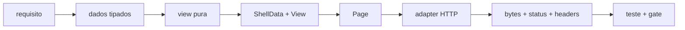

[← Projeto mínimo com Axum](16-projeto-minimo-axum.md) · [Índice](README.md) · [Próximo →](99-referencia-rapida.md)

# 17 — Guia de implementação

**Em uma frase.** Implemente a aplicação em fatias verticais — uma rota, uma view pura, um shell e um
adaptador HTTP — e só considere a fatia pronta quando os bytes, o teste e o gate aplicável existirem.

## O que este guia é

Este é o roteiro de execução para quem já decidiu usar `html-auy` e quer sair de “tenho requisitos” para
“tenho uma aplicação”. Ele não substitui as páginas de referência: cada fase aponta para a página que
explica a API em detalhe.

A ordem importa:

1. [00 — Filosofia](00-filosofia.md) define o que o crate aceita e o que deixa para a aplicação.
2. Este guia define a ordem de implementação.
3. [16 — Projeto mínimo com Axum](16-projeto-minimo-axum.md) mostra o esqueleto completo.
4. [99 — Referência rápida](99-referencia-rapida.md) resolve dúvidas de assinatura.

Para implementar a própria biblioteca, e não uma aplicação com ela, leia
[15 — Arquitetura](15-arquitetura.md) e o plano histórico em
[`docs/design/21`](../design/21-implementacao.md).

## O contrato de uma fatia

Uma fatia vertical é uma funcionalidade observável do começo ao fim. Ela começa em uma decisão de
domínio e termina em uma resposta HTTP com testes.



Uma fatia só termina quando:

- a view recebe dados já decididos e não faz I/O;
- o `Page` é a única fonte de `html`/`head`/`body`/`title`/`main`;
- o handler devolve status e headers corretos;
- existe um teste de bytes ou de comportamento para o caminho novo;
- o gate de acessibilidade/segurança aplicável foi executado.

Não comece pela página inteira. Comece pela rota mais simples que prova o fluxo. Depois acrescente
formulário, listagem, cache e estados de erro.

## Antes de escrever código

Decida explicitamente o que a aplicação possui. O crate não decide nada disso por você.

| Decisão | Pergunta | Onde ela vive |
|---|---|---|
| fonte de dados | SQL, HTTP, arquivo ou memória? | camada de consulta |
| identidade | ids são inteiros, UUIDs ou slugs? | tipos do domínio |
| rotas | qual é o contrato de URL e de `303`? | roteador |
| autenticação | quem cria a sessão e o `CsrfToken`? | middleware/serviço |
| locale | quando o texto é resolvido? | `Msg`/borda |
| assets | quem serve, versiona e cacheia CSS/JS? | `ServeDir`/CDN |
| CSP | há `style=` justificado? há CDN? | headers |
| cache | a página é pública, privada ou parcial? | `ETag`/`Cache-Control` |
| erros | 404/422/500 usam a mesma shell? | views de erro |
| observabilidade | o que é logado sem vazar dado pessoal? | aplicação |

Se uma dessas decisões não existir, o adapter HTTP vai tomá-la por acidente. O resultado costuma ser
`Html(format!(...))` no handler e uma página sem `lang`, sem título ou sem `main`.

## Fase 0 — Fundação

Objetivo: um workspace que compila, serve uma página e tem um ponto único de conversão para HTTP.

1. Crie o crate da aplicação com `html-auy` e o framework HTTP escolhido.
2. Separe `main.rs` (composição) de `app.rs`/`routes` (domínio e views).
3. Defina o erro da aplicação e o `PageResponse` que converte `Page` em resposta.
4. Monte um teste de fumaça que gera uma `Page` e compara os bytes.

O adapter é escrito uma vez e não vaza para as views:

```rust
struct PageResponse {
    status: StatusCode,
    page: html_auy::Page,
}
```

`Page` não implementa `IntoResponse` de propósito: status, headers, cookies e `ETag` são política da
aplicação. O exemplo completo está em [Projeto mínimo](16-projeto-minimo-axum.md) e as variações de
status/cache em [HTTP e integrações](12-http-e-integracoes.md).

**Aceite:** a rota inicial responde `200` com `Content-Type: text/html; charset=utf-8`, contém um único
`<h1>` e não usa `String` de HTML em nenhum ponto do handler.

## Fase 1 — Vocabulário do domínio

Objetivo: os dados que entram na view já têm tipo e significado.

- Modele ids, nomes, datas e estados com newtypes do seu domínio; não passe `String` crua até o markup.
- Defina o `enum M` que implementa `Msg` para os textos traduzíveis.
- Defina os `ClassToken`s do design system, em vez de montar classes por `format!`.
- Mantenha `Text`, `Href`, `Src`, `SrcSet`, `JsonLd` e `Timestamp` na fronteira da view, não no banco.
- Se a aplicação serve mídia de storage, implemente `MediaPath`; se usa variantes, implemente `Variant`.

O caminho é sempre “dado de domínio → tipo do crate → markup”:

```text
Product { name: ProductName, price: Money }
        ↓
view(&Product) -> Markup
        ↓
html! { h2 { Text::new(product.name.as_str()) } }
```

Os tipos disponíveis e o contexto de escape de cada um estão em
[Valores tipados](04-valores-tipados.md); tradução e nomes acessíveis em
[Texto e i18n](05-texto-e-i18n.md).

**Aceite:** nenhuma view recebe `String` de HTML, nenhum componente busca dados e todo texto vindo do
usuário passa por `Text` ou por um tipo equivalente.

## Fase 2 — Primeira rota vertical

Objetivo: uma rota completa, do banco ao `<main>`.

1. O handler carrega os dados e trata “não encontrado” antes de renderizar.
2. A view devolve `Markup` e não conhece status HTTP.
3. O handler monta `ShellData` e `View`, chama `Page::new` e entrega ao adapter.
4. O teste verifica título, `h1`, conteúdo principal e ausência de HTML indesejado.

```rust
fn product_page(product: &Product) -> Page {
    let shell = ShellData::new(
        Text::new(product.name.as_str()),
        Text::new(product.name.as_str()),
        Lang::parse("pt-BR").expect("constante"),
    );
    let view = View::new(html! {
        section {
            h2 { Text::new("Detalhes") }
            p { Text::new(product.description.as_str()) }
        }
    });
    Page::new(&shell, view)
}
```

A página começa em [Primeira página](02-primeira-pagina.md). O contrato do macro e os erros de
compilação estão em [O macro `html!`](03-macro-html.md).

**Aceite:** a rota tem teste de sucesso e de ausência; a view não conhece `StatusCode`; o `h1` vem do
`Page` e não da view.

## Fase 3 — Shell e assets

Objetivo: todas as páginas compartilham a mesma moldura.

- O shell define `lang`, título, `h1`, meta, navegação, skip link, regiões e rodapé.
- O skip link e a região viva já vêm do `Page`; não recrie esses elementos na view.
- Assets são `Asset`s externos, declarados em ordem estável; não há `<script>` inline nem `<style>`.
- Classes do root, tema e `data-*` são valores tipados do shell, não strings montadas na mão.
- O CSS deve estilizar os componentes; `style=` é escape hatch auditado e exige CSP compatível.

A página canônica é [Shell, assets e tema](08-shell-assets-e-tema.md); a fronteira de segurança e CSP
está em [Segurança](10-seguranca.md).

**Aceite:** duas páginas diferentes usam o mesmo shell; o skip link aponta para `main`; nenhum asset é
inline; o `ETag` da página é estável para o mesmo conjunto de assets.

## Fase 4 — Formulários

Objetivo: um formulário que valida, erra e redireciona sem perder acessibilidade.

1. O `GET` monta o formulário com `Form::open` e um `CsrfToken` vindo da sessão.
2. O `POST` valida antes de renderizar; erro de campo vira `FieldState` e status `422`.
3. Sucesso faz `303` para uma rota `GET`; não renderize a página de sucesso no `POST`.
4. `Field`/`FieldState` derivam `label`, `id`, ajuda, erro e `aria-*`; não escreva esses atributos à mão.
5. O formulário nunca é montado fora de `Form::open`; o token mora no tipo do método.

A página completa é [Formulários](06-formularios.md). O fluxo HTTP de `303`/`422` e a resposta parcial
estão em [HTTP e integrações](12-http-e-integracoes.md).

**Aceite:** o formulário tem `label` associado, erro anunciado, token CSRF no `POST` e um teste para o
caminho inválido e para o redirecionamento.

## Fase 5 — Dados e listas

Objetivo: listas grandes continuam determinísticas e acessíveis.

- A consulta devolve uma coleção já ordenada; a view não ordena por `HashMap`.
- A view mapeia itens para `Markup`; não há acesso a banco, sessão ou rede dentro do componente.
- Paginação, estado vazio e estado de erro são views explícitas, não `unwrap()` no template.
- Listas usam os elementos semânticos do vocabulário; células de tabela usam `th` com `scope`.
- Textos e classes dinâmicas vêm de `Msg`/`ClassToken`, não de concatenação livre.

O padrão de composição, listas e classes dinâmicas está em
[Conteúdo dinâmico](09-conteudo-dinamico.md). Receitas concretas ficam em [Receitas](14-receitas.md).

**Aceite:** a ordem da lista é estável entre execuções; a página tem estado vazio; nenhum componente
recebe um `Repository` ou abre conexão.

## Fase 6 — Fronteira HTTP

Objetivo: status, headers e cache são decididos uma vez, no adapter.

| Situação | Resposta |
|---|---|
| página encontrada | `200` + `Page` |
| recurso ausente | `404` + página de erro com o mesmo shell |
| formulário inválido | `422` + página com `FieldState` |
| `POST` concluído | `303` + `Location` |
| erro interno | `500` + página genérica, sem detalhe sensível |
| página pública | `ETag`/`Cache-Control` sobre os bytes finais |
| página personalizada | `Cache-Control: private`; não reutilize `ETag` público |
| atualização parcial | `Partial` + headers de `Vary` coerentes |

O `ETag` é calculado sobre os bytes finais — `page.markup().as_str()` antes de consumir a `Page` —,
não sobre o modelo. Compressão e `Vary` precisam considerar o mesmo conteúdo.

**Aceite:** cada status tem teste; a página de erro usa `Page`; cache público e privado não
compartilham `ETag`; a resposta parcial não monta o documento inteiro.

## Fase 7 — Gates de acessibilidade, segurança e testes

Objetivo: a fatia não regride o que o crate garante.

- Rode `audit` sobre fixtures de página inteira quando a feature estiver habilitada.
- Rode `axe`, navegação por teclado e verificação de contraste no gate do consumidor.
- Teste o caminho de erro e o caminho de sucesso, não só o “feliz”.
- Teste o HTML final por bytes quando a saída for contrato (título, `h1`, ordem de assets, `ETag`).
- Verifique CSP: `style=` exige justificativa; scripts são arquivos externos; não há `on*`.

O crate não substitui esses gates. O que é garantido por tipo/macro/audit está em
[Acessibilidade](11-acessibilidade.md); o que continua sendo teste do consumidor está em
[Testes e diagnóstico](13-testes-e-diagnostico.md).

**Aceite:** `audit` verde nas fixtures; `axe` sem violação crítica; teclado alcança skip link, navegação
e formulário; CSP não precisa de `unsafe-inline` para o caminho normal.

## Fase 8 — Operação

Objetivo: a aplicação continua previsível depois do deploy.

- Assets versionados são servidos com cache longo; HTML é servido com política explícita.
- Erros de produção não vazam SQL, caminho de arquivo ou dado pessoal.
- Logs registram rota, status e latência; não registram corpo de formulário nem token.
- O build fixa a versão do crate e roda `cargo test`/`clippy` no CI.
- Rollback é possível sem migração de banco irreversível.

O crate não faz deploy, compressão, CDN ou observabilidade. Essas decisões ficam na aplicação; as
implicações de cache/headers estão em [HTTP e integrações](12-http-e-integracoes.md).

**Aceite:** página pública e privada têm cache correto; log não contém segredo; o deploy falha se o
teste de bytes ou o gate de acessibilidade falhar.

## Estrutura de arquivos sugerida

```text
site/
├── Cargo.toml
├── public/                 # CSS, JS e imagens servidos como Asset
├── src/
│   ├── main.rs             # composição: config, router, estado, serve
│   ├── app.rs              # AppError, PageResponse e helpers de resposta
│   ├── domain/             # tipos e consultas; nada de HTML
│   ├── routes/             # handlers; carregam dados e escolhem status
│   ├── views/              # funções puras: dados -> Markup/Page
│   └── shell.rs            # ShellData, navegação e assets comuns
└── tests/
    ├── pages.rs            # bytes, títulos, h1, links
    └── forms.rs            # 422, 303, CSRF e erros de campo
```

Essa divisão não é obrigatória; ela só torna visível a regra: **domínio não conhece HTML, view não
conhece I/O, adapter não conhece regra de negócio.**

## Checklist de aceitação por fatia

- [ ] A rota tem sucesso, ausência e erro cobertos.
- [ ] A view recebe dados prontos e devolve `Markup` ou `Page`.
- [ ] O `Page` é o único emissor de `html`/`head`/`body`/`title`/`main`.
- [ ] Texto do usuário passa por `Text`; URL/mídia passa pelo tipo correto.
- [ ] Formulário usa `Form::open`, `FieldState` e CSRF; `POST` bem-sucedido faz `303`.
- [ ] Assets são externos, ordenados e versionados; não há `on*`/`<style>`/script inline.
- [ ] Status, headers, `ETag` e `Vary` são decididos no adapter.
- [ ] `audit`, `axe` e teclado foram executados quando aplicáveis.
- [ ] O teste falha se o HTML canônico mudar sem intenção.
- [ ] Não há `unwrap`/`expect` em caminho de request, código morto ou placeholder.

## Anti-padrões

| Anti-padrão | Por que falha | Faça em vez disso |
|---|---|---|
| `Html(format!("<h1>{}</h1>", title))` | perde escape, shell e acessibilidade | monte `Page` com `View`/`ShellData` |
| regra de negócio dentro da view | a view deixa de ser pura e testável | carregue no handler/domínio |
| componente que busca dados | esconde I/O e quebra composição | passe o dado pronto |
| `Page` com status/cookie | acopla documento a HTTP | devolva `Page` ao adapter |
| formulário sem `CsrfToken` | CSRF deixa de ser tipo | use `Form::open` com token de sessão |
| `ETag` do modelo | cache diverge do HTML final | hash dos bytes finais |
| `style=` sem CSP | o navegador bloqueia ou exige `unsafe-inline` | classe no asset CSS |
| `audit` em produção | custo e dependência desnecessários | gate de CI/fixtures |
| lista ordenada por `HashMap` | bytes instáveis e `ETag` inútil | `Vec`/`BTreeMap` com ordem explícita |

## Ordem de leitura

Para implementar uma aplicação:

**00 → 01 → 02 → 17 → 16 → 06 → 12 → 13**

Para consultar uma decisão específica, use a [Referência rápida](99-referencia-rapida.md). Para entender
por que a API é assim, volte à [Filosofia](00-filosofia.md).

---

[← Projeto mínimo com Axum](16-projeto-minimo-axum.md) · [Índice](README.md) · [Próximo →](99-referencia-rapida.md)
